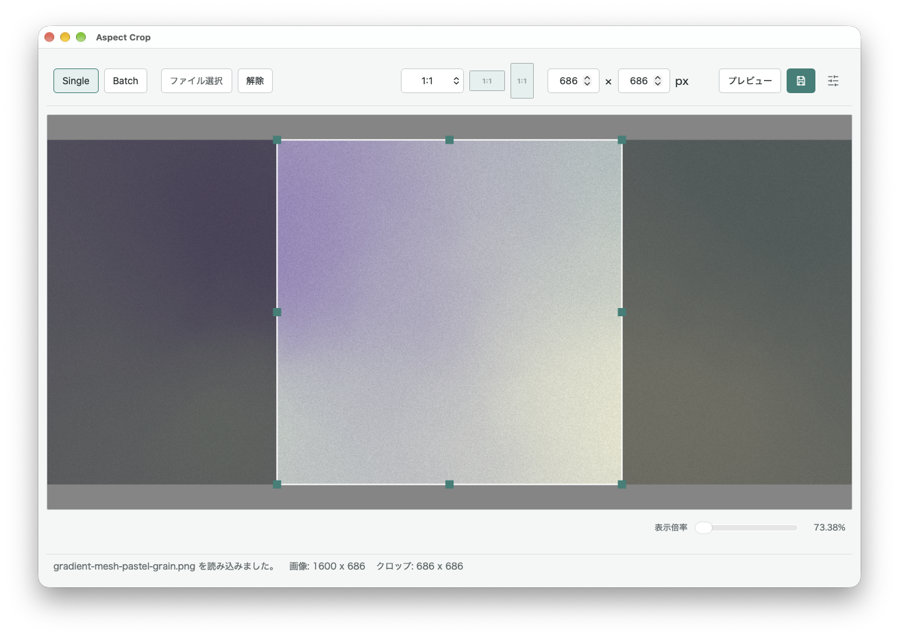
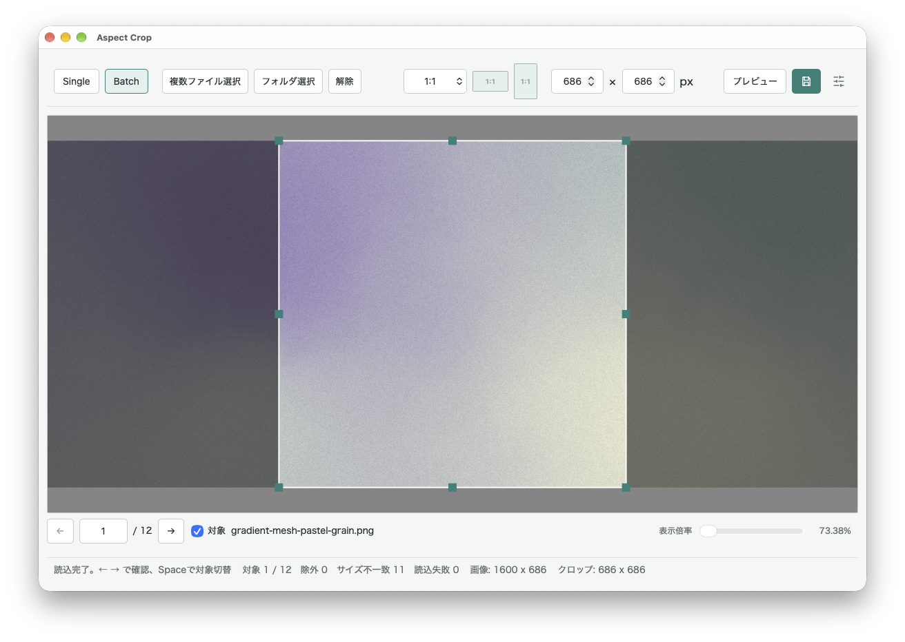
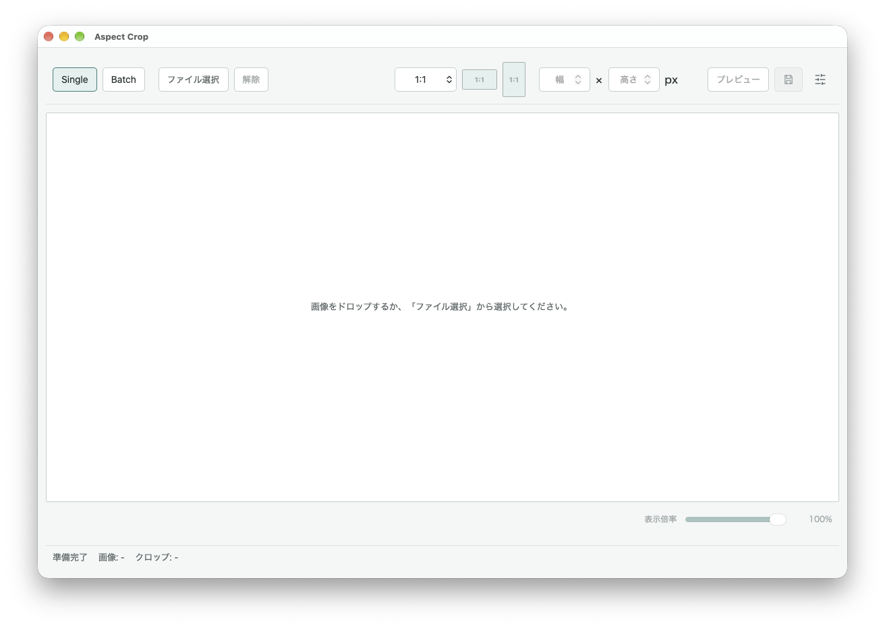

# Aspect Crop

固定アスペクト比での切り抜きに特化した、macOS向け画像クロップツールです。

1枚ずつ編集する **Single** と、同じクロップ範囲を複数画像へまとめて適用する **Batch** の2モードを備えています。

日本語 / English のUIに対応しています。

## Screenshots

### Single mode



### Batch mode



<details>
<summary>Initial screen / 初期画面</summary>

<br>



</details>

---

## Overview

画像を決まったアスペクト比に整えて保存したいだけなのに、一般的な画像編集アプリでは操作が用途に対して大きすぎたり、固定比率での位置調整や複数画像への同一処理に手間がかかることがありました。

Aspect Cropでは、

- 固定アスペクト比を選ぶ
- クロップ枠を動かして構図を調整する
- 必要ならピクセル単位でサイズを指定する
- 結果を確認する
- 指定した形式で保存する

という処理に絞っています。

多機能な画像編集ソフトではなく、**固定アスペクト比でのクロップ作業を少ない操作で行うための小さなデスクトップユーティリティ**として開発しています。

---

## Features

### Single crop

1枚の画像を編集・保存するモードです。

- ファイル選択
- ドラッグ＆ドロップ
- 固定アスペクト比でのクロップ
- 横向き / 縦向きの切り替え
- カスタムアスペクト比の追加・並べ替え・削除
- クロップ枠のドラッグ移動
- アスペクト比を維持したリサイズ
- ピクセル単位でのクロップサイズ指定
- クロップ結果のプレビュー
- 全体表示〜100%の表示倍率変更
- 保存ダイアログから保存先・ファイル名を指定
- 複数画像を選択した場合は別ウィンドウで開くデスクトップ動作

### Batch crop

同じサイズの複数画像へ、**同一の元画像ピクセル座標のクロップ範囲**をまとめて適用するモードです。

入力方法：

- 複数画像を選択
- フォルダを選択
- 画像ファイルをドラッグ＆ドロップ
- フォルダをドラッグ＆ドロップ

フォルダ入力では、フォルダ直下の対応画像を対象とします。サブフォルダの再帰検索は行いません。

ファイルとフォルダの混在ドロップ、複数フォルダの同時ドロップには対応していません。

Batchでは最初に利用可能な画像のサイズを基準として、

```text
基準サイズと一致
→ 処理対象

サイズが異なる
→ size-mismatch
→ 処理対象にできない

読み込み不可
→ invalid
```

として分類します。

処理可能な画像は、個別に対象 / 除外を切り替えられます。

### Batch navigation

Batch内の画像は、

- 前へ / 次へボタン
- ← / → キー
- 画像番号の直接入力

で移動できます。

`Space` キーで現在の画像を処理対象から除外 / 再追加できます。

サイズ不一致画像や読み込み不能画像は確認できますが、処理対象にはできません。

---

## Crop controls

| 操作 | 動作 |
| --- | --- |
| クロップ枠内をドラッグ | クロップ位置を移動 |
| ハンドルをドラッグ | アスペクト比を維持してリサイズ |
| 幅・高さを入力 | 選択中の比率を維持してサイズ指定 |
| 矢印キー | 1px単位で移動 |
| Shift + 矢印キー | 10px単位で移動 |
| 画像上でマウスホイール | クロップ枠を中心から拡大・縮小 |
| + / − キー | クロップ枠を中心から拡大・縮小 |

クロップ範囲は元画像のピクセル座標として保持されます。

表示倍率を変更しても、保存されるクロップ位置や出力サイズは変化しません。

---

## Zoom

クロップ画面とプレビュー画面には、それぞれ独立した表示倍率があります。

表示範囲は **全体表示〜100%** です。

- **全体表示**  
  画像全体が表示領域に収まる倍率

- **100%**  
  元画像を等倍相当で確認する表示

画像が表示領域を超える場合のみスクロールできます。

クロップ画面とプレビュー画面の倍率は共有されません。

---

## Aspect ratios

標準で以下のアスペクト比を用意しています。

```text
16:9
4:5
5:7
4:3
3:5
3:2
2:1
1:1
```

任意の比率をカスタム登録することもできます。

保存したカスタム比率は、

- 選択
- 並べ替え
- 削除

が可能です。

---

## Output formats

以下の出力形式に対応しています。

| 選択肢 | 保存方法 |
| --- | --- |
| 元画像と同じ | 元画像の形式を維持 |
| PNG | 可逆 |
| JPEG | 最高品質 |
| WebP | 可逆 |
| BMP | 可逆 |

入力した静止GIFをGIFのまま保存する場合は、**元画像と同じ**を使用します。

JPEGにはアルファチャンネルがないため、透明部分は白背景へ合成して保存します。

---

## WebP lossless compression

WebP出力では、3種類のロスレス圧縮プリセットを選択できます。

| 設定 | 特徴 |
| --- | --- |
| 高速 / Fast | 保存時間を優先 |
| 標準 / Balanced | 初期値 |
| サイズ優先 / Smallest | ファイルサイズを優先 |

すべてロスレスで、画素内容は保持されます。

違いは主に圧縮処理時間と出力ファイルサイズです。

設定はSingle / Batch共通で、**元画像と同じ**を選択してWebPを出力する場合にも適用されます。

現在の内部設定：

| Preset | quality | method |
| --- | ---: | ---: |
| Fast | 20 | 0 |
| Balanced | 75 | 4 |
| Smallest | 100 | 6 |

lossless時の `quality` は画質ではなく圧縮探索量として使用されます。

---

## Batch output

Batch保存時には、

- 出力フォルダ
- 出力形式
- WebP圧縮設定
- 同名ファイルの扱い

を指定します。

同名ファイルの処理方法：

```text
Rename
→ 連番を付けて保存

Skip
→ 既存ファイルをスキップ

Overwrite
→ 既存ファイルを上書き
```

Batch内の複数入力が同じ出力先へ解決される場合は、入力順による上書きを避けるため、その入力を失敗として扱います。

例えば、

```text
folder-a/a.png
folder-b/a.png
```

や、

```text
a.png
a.bmp
↓ PNG出力
a.png
a.png
```

のようなケースです。

`Overwrite` は既に存在する出力ファイルを上書きするための設定であり、Batch内の画像同士を上書きさせる設定ではありません。

---

## Batch processing

大量画像を扱うことを想定し、Batchでは画像をすべてメモリへ展開して保持しません。

### Scan

入力時の検証では主に、

```text
形式
サイズ
アニメーション判定
基本的なファイル整合性
```

を確認します。

全画像のピクセルデータを一度にデコードせず、必要なmetadataを順番に取得します。

### Preview

現在表示している1画像だけを読み込みます。

画像一覧全体のデコード済みキャッシュやサムネイルキャッシュは保持しません。

### Save

保存処理も1画像ずつ順番に行います。

```text
open
↓
decode
↓
crop
↓
encode
↓
save
↓
release
↓
next
```

1件の画像処理に失敗しても、可能な限り残りの画像処理を継続します。

---

## Batch safety

Batchでは、個別画像の失敗とBatch全体の問題を分けて扱っています。

### Individual file error

例えば、

- 入力ファイルが削除された
- ファイルを開けない
- decodeに失敗した
- 実行時に画像サイズが変化した

場合は、そのファイルだけを `failed` とし、他の画像の処理を続行します。

### Batch-level error

例えば、

- 出力フォルダを作成できない
- 出力フォルダへ書き込めない
- 入力元フォルダそのものを出力先として指定した
- クロップ範囲自体が不正

といったBatch全体として安全に処理できない場合は、Batchを中止します。

出力時は一度一時ファイルへエンコードしてから最終出力へ反映し、エンコード失敗によって既存ファイルを途中まで破壊しないようにしています。

---

## Initial folder for Single save

Singleの保存ダイアログを開く際の初期フォルダを設定できます。

- 元画像と同じフォルダ
- 前回保存したフォルダ
- 指定したフォルダ

この設定は保存先を固定するものではなく、保存ダイアログを最初に開く位置だけを指定します。

---

## Supported images

入力：

- PNG
- JPEG / JPG
- WebP
- GIF
- BMP

静止画像のみを対象としています。

以下のアニメーション画像には対応していません。

- Animated GIF
- Animated WebP
- APNG

---

## Single / Batch sessions

SingleとBatchはそれぞれ独立した編集状態を持ちます。

例えば、

```text
Singleで画像を編集中
↓
Batchへ切り替える
↓
Batchを操作
↓
Singleへ戻る
↓
Singleの編集状態を復元
```

という使い方ができます。

同じ編集画面を共有しつつ、モードごとの入力画像やクロップ状態を保持しています。

---

## Language

UIは以下に対応しています。

- 日本語
- English

初回起動時はOS / ブラウザの言語を参照します。

設定画面で変更した言語は保存され、次回起動時にも使用されます。

---

## Implementation notes

### Source coordinates and display coordinates

クロップ範囲は元画像のピクセル座標で保持します。

```text
元画像座標
↓
表示倍率
↓
画面上の座標
```

表示倍率は画面描画にのみ使用され、保存処理には影響しません。

### Crop validation

保存時にはRust側でもクロップ範囲を検証します。

不正な座標を自動補正して別の範囲を保存するのではなく、処理を失敗させます。

これにより、フロントエンド側の座標計算に問題が発生した場合でも、意図しない範囲を保存しにくい構成にしています。

### Desktop / browser separation

デスクトップ版ではTauriを通して、

- ファイル / フォルダ選択
- ネイティブファイルパス
- Drag & Drop
- 保存ダイアログ
- ネイティブ画像保存
- Batch
- 複数ウィンドウ

を扱います。

ブラウザ実行は主にUI・Single機能の確認用です。

ブラウザではBatchは利用できず、SingleのPNG / JPEGダウンロード保存に対応しています。

---

## Tech stack

- TypeScript
- HTML / CSS
- Vite
- Tauri
- Rust
- `image` crate
- `webp` / libwebp

UI、編集状態、座標操作は主にTypeScript側で管理し、画像の検証・クロップ・エンコード・ファイルI/OはRust / Tauri側で処理しています。

---

## Development

### Requirements

macOSでの開発には以下が必要です。

- Node.js / npm
- Rust / Cargo
- Xcode Command Line Tools

依存関係をインストール：

```bash
npm install
```

デスクトップ版を開発起動：

```bash
npm run tauri -- dev
```

開発起動時は利用可能なViteポートを自動選択します。

ブラウザでUIを確認：

```bash
npm run dev
```

---

## Tests

TypeScript側：

```bash
npm test
```

Rust側：

```bash
cargo test --manifest-path src-tauri/Cargo.toml
```

フロントエンドの型チェックとproduction build：

```bash
npm run build
```

テストでは、主に以下を確認しています。

- crop geometry
- zoom / coordinate conversion
- language settings
- save folder settings
- Single / Batch mode switching
- Batch classification
- Batch include / exclude
- Batch navigation
- Batch Drag & Drop
- size mismatch
- per-file error continuation
- output collision policies
- duplicate output destination protection
- image format handling
- WebP compression settings
- existing output protection

---

## Build

macOS向けデスクトップアプリ：

```bash
npm run tauri -- build
```

Tauriのbundle設定により `.app` を生成します。

アプリ名：

```text
Aspect Crop
```

Bundle identifier：

```text
com.y8m.aspectcrop
```

現在のpackage version：

```text
0.1.0
```

---

## Current status

現在はmacOS向け個人利用ツールとして開発しています。

主要なSingle / Batch crop機能、Drag & Drop、出力設定、テスト、アプリアイコン、macOS向けbundle生成まで実装しています。

Windows向けの実機検証は現時点では行っていません。
